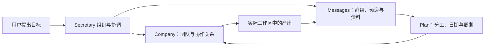

# Avalon 三视图真实运行图库

[项目与 Star 入口](https://github.com/Daijunfan/Avalon) · [打开图库](index.html) · [素材清单与验收数据](manifest.json)

2026-10-04：共 **32 张图片 + GIF / MP4 动画**，按 Company、Messages、Plan 三个视图保存。三个宣传目录及其子目录已全部使用英文名称；未来命名规则已写入项目 AGENTS.md。

| 视图 | 图片 | 重点 |
| --- | ---: | --- |
| Company | 8 | 中央秘书、六位 Manager、每位两名员工、四种 Coding Agent、四个 SSH 工作环境 |
| Messages | 9 | 秘书创建群组、@ 点名、选择性回复、全部成员共享上下文、新闻与 AI 摘要 |
| Plan | 15 | 38 项保存的排期、10 种布局、月历与每日详情、周计划、两次真实成功执行记录 |

## 先看这几张

- [Company 完整工作全景](Company/company-hierarchy-working.png)：19 个角色；18 个工作、1 个休息。工作角色都有消息框，休息角色保留未读回复提示。
- [绿色虚线流动 GIF](Company/company-green-flow.gif) / [原始运行片段 MP4](Company/company-green-flow.mp4)：从真实 Chrome 录像中截取，保留实际虚线位移。
- [Secretary 创建出行群](Messages/group-secretary-creates-weekend-team.png)：用户说出两天、1800 元的目标，小队先补齐信息，再安排路线与预算。
- [全部成员已读，只有两名员工执行](Messages/group-shared-context-receipts-detail.png)：两名被 @ 的成员公开回答，四名其他成员“仅知悉”，六名成员均已读。
- [频道里的新闻与真实 AI 摘要](Messages/channel-news-and-ai-summary.png)：保留原帖、来源、图像和员工署名。
- [月历](Plan/plan-calendar.png)、[一天八项安排](Plan/plan-calendar-day-agenda.png)、[周计划](Plan/plan-week.png)、[真实执行记录](Plan/plan-execution-feed.png)。

## 三个视图如何处理同一件事

Company 展示人员、职责、引擎与工作环境，让用户看清谁负责、谁协作、谁正在执行。Messages 让同一批员工进入群组和频道，把用户目标、资料、讨论与 AI 回答放到同一处。Plan 将已确定的工作安排到日期、周期或事件上，并记录实际执行结果。

本图库用读书会、周末出行和资讯整理串起这条流程：秘书先组织团队和会话；用户在群中点名提出问题；员工共享背景并选择回应；明确的工作进入排期。三个视图围绕同一批员工和 Core 数据展开。

## 连线与画面验收

18 条连接均为实际保存的 Core 路线。秘书的左右三组连接严格镜像；六个团队的两条员工分支长度相同、位置对称。几何交叉、连线穿过消息框、消息框互相覆盖、消息框覆盖其他角色均为 **0**。中间一排使用直接水平连接；秘书团队的装饰避开连接区域。

消息框优先展示引擎返回的文字和工具活动。引擎尚未返回内容时，显示当前真实任务。绿色线表示实际通信提示，工作状态由运行中的任务决定。主图中共有 16 条绿色通信连接；100 毫秒前后记录了虚线位移。

## 实拍来源与范围

使用当前工作区 0.58.0 源码的独立构建，以及独立数据目录中的实际 Coding Agent。引擎在 Mac Core 执行，通过 SSH 使用 Linux、Windows、Ubuntu/Kali 虚拟机的实际工作区；截图分别显示执行位置与工作环境。角色、任务、会话和工作状态均来自实际 Core 操作。画面保留运行版本的兼容名称 Anexus；项目名称和分享链接为 Avalon。

三个群组由实际 Secretary 引擎创建。周末出行场景核验了六名成员全部已读、两名被 @ 的成员回答、四名成员仅共享上下文。频道的三条原帖及图像来自当前已保留的公开 Telegram 数据，复制到拍摄实例后由实际员工生成摘要；原始频道地址与发布时间保留。

Plan 图片中的未来事项是已保存的排期；两次手动资料核验都有实际成功执行记录。表单图为未提交的真实界面草稿。拍摄结束后，38 项排期已全部暂停，后台模型任务与拍摄 Core 已停止。

## 本轮源码修复与验证

- 进度订阅断开后，readline 接收器处理连接错误，避免 EPIPE 导致 Core 退出。
- 先过滤其他会话的事件，再检查订阅权限，减少不相关事件的重复工作。
- 执行中的员工尚无引擎输出时，消息框展示当前提交的任务；引擎输出和已完成未读回复继续按原语义展示。

通过：TypeScript 检查、独立应用构建、活动消息单测、Core IPC 断线/权限/协作生命周期回归、真实角色与 SSH 场景、布局碰撞和镜像验收。早期拍摄实例的 EPIPE 失败已修复并回归。部分场景中的长任务在拍摄结束时中止，工作截图不作为所有任务均完成的证明。

未测试：Windows/Linux 桌面打包和安装。本轮 SSH 工作区验证与桌面平台验证分别记录。原有图库完整保存在项目忽略的 artifacts 拍摄档案中。
